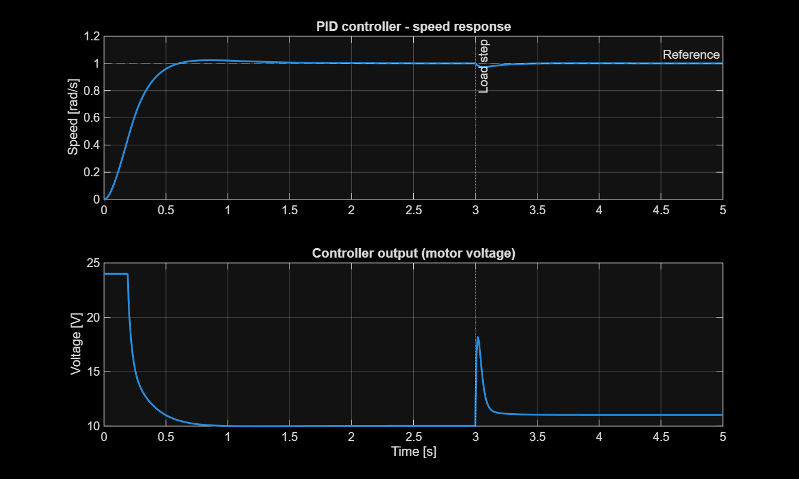
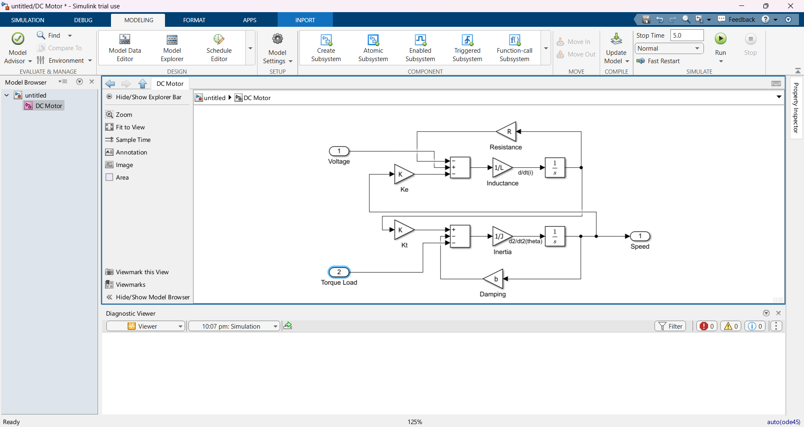
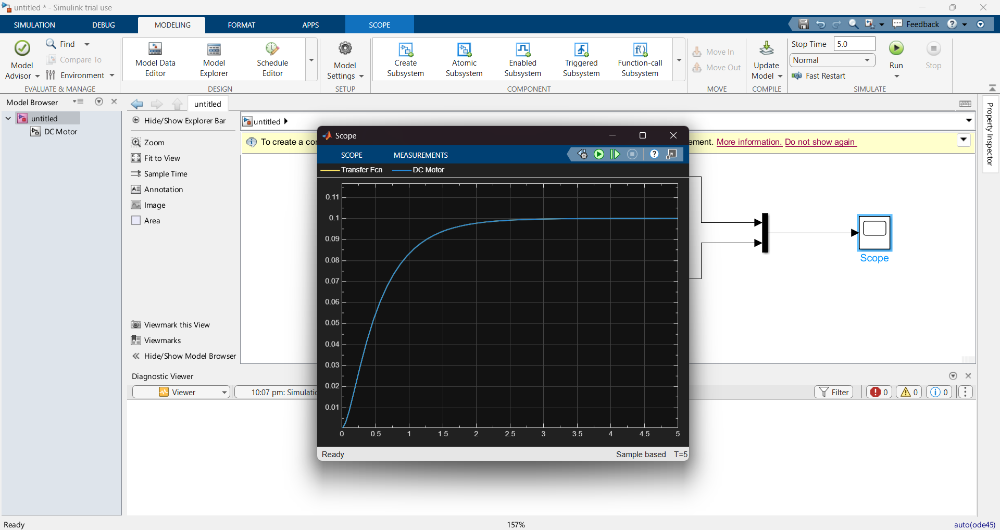
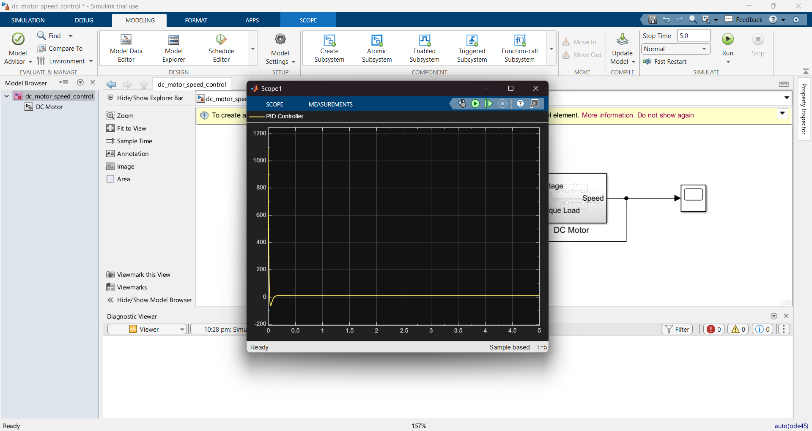

# DC Motor PID Speed Control (MATLAB/Simulink)

PID speed control of a DC motor in MATLAB/Simulink, from first-principles modelling to automated, requirement-based Model-in-the-Loop (MIL) testing.



## Overview

This project follows a Model-Based Development workflow:

1. **Requirements:** define what "good" means, in numbers
2. **Plant model:** build the DC motor from its physical equations
3. **Model verification:** check the model against an independent transfer function
4. **Control law:** design P, PI and PID controllers with realistic actuator limits
5. **MIL testing:** a MATLAB script runs every test case and checks each requirement automatically (PASS/FAIL)

## System model

The motor is modelled from its electrical and mechanical equations:

- Electrical: `L·di/dt = V − R·i − K·ω`
- Mechanical: `J·dω/dt = K·i − b·ω − T_load`



### Parameters

| Parameter | Description | Value |
|---|---|---|
| J | Rotor inertia | 0.01 kg·m² |
| b | Viscous friction | 0.1 N·m·s |
| K | Motor constant (Kt = Ke) | 0.01 |
| R | Armature resistance | 1 Ω |
| L | Armature inductance | 0.5 H |

Source: University of Michigan, *Control Tutorials for MATLAB & Simulink* (DC Motor Speed example).

## Requirements

| ID | Requirement |
|---|---|
| REQ-01 | Settling time (2% band) < 2 s for a 1 rad/s speed step |
| REQ-02 | Overshoot < 5% |
| REQ-03 | Steady-state error < 1% |
| REQ-04 | After a load torque step, speed returns within 2% of the reference in < 1 s |

## Model verification

Before designing a controller, the block-diagram model was compared with the transfer function derived from the same equations:

`G(s) = K / ((Js + b)(Ls + R) + K²)`

Both responses to a 1 V step overlap exactly and settle at 0.0999 rad/s, matching the theoretical value K / (bR + K²).



## Controller design

| Controller | Kp | Ki | Kd |
|---|---|---|---|
| P | 100 | 0 | 0 |
| PI | 100 | 200 | 0 |
| PID | 100 | 200 | 10 |

- **P** responds quickly but leaves a steady-state error.
- **I** removes the steady-state error.
- **D** damps the response and improves disturbance rejection.

### Realistic actuator limits

Without limits, the PID controller requested a voltage spike of about 1,200 V at start-up (derivative kick), which no real motor supply can deliver. The controller output is therefore saturated at **±24 V** with **clamping anti-windup**.



### Load disturbance

At t = 3 s, a load torque step of 0.01 N·m is applied (about 10% of the friction torque at the operating speed) to test disturbance rejection.

## Design decisions

- **Equations instead of a transfer function block:** modelling from first principles makes it possible to inject a load torque and observe the motor current. The transfer function is kept as an independent reference to verify the model.
- **Parameters in one script:** `params.m` runs automatically through the model's InitFcn callback, so the model always uses consistent values.
- **Gains as variables:** the PID block reads `Kp`, `Ki` and `Kd` from the workspace, so the test script can run every controller without editing the model.

## MIL test results

`run_tests.m` runs the model for each controller, measures the response and checks every requirement automatically.

| Controller | Rise time [s] | Overshoot [%] | Settling time [s] | SS error [%] | Max load dip [%] | Recovery [s] | REQ-01 | REQ-02 | REQ-03 | REQ-04 |
|---|---|---|---|---|---|---|---|---|---|---|
| P | 0.24 | 9.33 | 0.70 | 9.10 | 13.64 | not recovered | PASS | FAIL | FAIL | FAIL |
| PI | 0.27 | 0.94 | 1.21 | 0.05 | 4.52 | 0.18 | PASS | PASS | PASS | PASS |
| PID | 0.34 | 2.32 | 1.02 | 0.007 | 2.69 | 0.13 | PASS | PASS | PASS | PASS |

## Key findings

- **P alone cannot meet the requirements:** it leaves about 9% steady-state error and never returns within the 2% band after the load step.
- **The actuator limit changed the PI result.** Without the voltage limit, PI overshot by about 30%. With the ±24 V limit and anti-windup, its overshoot dropped below 1% and it passed all requirements. Automated testing on the realistic model caught what visual inspection of the earlier, unlimited model suggested otherwise.
- **PID was selected** for its better disturbance rejection: a smaller load dip (2.7% vs 4.5%), faster recovery (0.13 s vs 0.18 s) and lower steady-state error. The trade-off is that the D term is sensitive to sensor noise on real hardware, which is why PI is also a reasonable choice.
- **Physical consistency check:** under load, the steady-state voltage rises from about 10 V to about 11 V, matching the extra current needed to supply the additional 0.01 N·m.

## Repository structure

```
dc-motor-pid-speed-control/
├── models/
│   ├── dc_motor_openloop_verification.slx   # plant model vs transfer function
│   └── dc_motor_speed_control.slx           # closed-loop PID model
├── scripts/
│   ├── params.m                             # motor parameters and test conditions
│   └── run_tests.m                          # automated MIL tests
├── docs/
│   └── requirements.md
├── images/
└── results/
    └── test_results.csv
```

## How to run

1. Open MATLAB (built with R2026b) and set the Current Folder to the repository root.
2. Add the `models` and `scripts` folders to the path.
3. Run `run_tests` in the Command Window.

The script prints the results table, saves it to `results/test_results.csv` and saves the plots to `images/`.

## Next steps

- Fixed-point conversion of the controller
- Code generation and Software-in-the-Loop (SIL) back-to-back testing
- Deployment on a microcontroller (ESP32/Arduino) with a real motor and encoder
